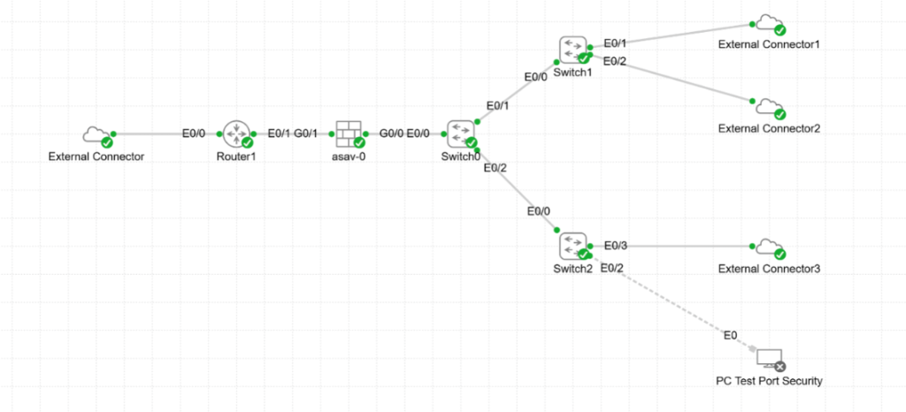

# NETWORK SIMULATIONS (CISCO PACKET TRACER & EVE-NG / GNS3)

Thư mục lưu trữ các sơ đồ thiết kế và file mô phỏng hệ thống mạng an toàn cho doanh nghiệp TechCorp trên hai nền tảng: **Cisco Packet Tracer (v8.2+)** và **EVE-NG / GNS3**.

---

## 🗺️ 1. Sơ đồ mô phỏng thực nghiệm EVE-NG / GNS3

Mô hình thực nghiệm lab kết nối giữa các thiết bị mạng ảo hóa chuyên nghiệp (Cisco Router, Cisco ASAv, Cisco IOL Switches) và cụm máy ảo giám sát an toàn thông tin (Wazuh SIEM, Linux Services, Windows Client, Kali Linux Pentest).



### 📌 Cấu trúc liên kết & Luồng dữ liệu (Topology Flow):

```text
               [ External Connector (WAN / NAT) ]
                               │ E0/0
                          [ Router1 ]
                               │ E0/1
                               │ G0/1
                        [ asav-0 (ASAv) ]
                               │ G0/0
                               │ E0/0
                         [ Switch0 (Core) ]
                        ┌──────┴──────┐
                   E0/1 │             │ E0/2
                   E0/0 │             │ E0/0
                   [ Switch1 ]   [ Switch2 ]
                  ┌─────┴─────┐       ┌─────┴─────┐
             E0/1 │      E0/2 │  E0/3 │      E0/2 │
                  │           │       │           : (Port Security Violation - Shutdown)
               [Cloud1]    [Cloud2] [Cloud3]    [PC Test Port Security]
              (VM Wazuh)   (VM Web) (VM Win/Kali)
```

### 📊 Bảng ánh xạ cổng và vai trò thiết bị trong mô hình EVE-NG / GNS3:

| Node / Thiết bị | Cổng | Kết nối tới | Vai trò kiến trúc an ninh |
| :--- | :--- | :--- | :--- |
| **External Connector** | Cloud | `Router1` (E0/0) | Cổng kết nối ra ngoài Internet / NAT Gateway môi trường thực tế. |
| **Router1** | `E0/0`<br>`E0/1` | `External Connector`<br>`asav-0` (G0/1) | Biên định tuyến dịch vụ mạng; tiếp nhận và phân phối lưu lượng ra vào tường lửa. |
| **asav-0** (Cisco ASAv) | `G0/1` (Outside)<br>`G0/0` (Inside) | `Router1` (E0/1)<br>`Switch0` (E0/0) | Tường lửa kiểm soát biên an ninh Statefull Packet Inspection; phân tách vùng Outside không tin cậy và vùng Inside nội bộ. |
| **Switch0** (Core Switch L3) | `E0/0`<br>`E0/1`<br>`E0/2` | `asav-0` (G0/0)<br>`Switch1` (E0/0)<br>`Switch2` (E0/0) | Switch trung tâm định tuyến Inter-VLAN L3, kết nối vùng Inside của Firewall và phân phối 2 nhánh Switch mạng nội bộ qua Trunk link. |
| **Switch1** (Phân vùng Dịch vụ) | `E0/0`<br>`E0/1`<br>`E0/2` | `Switch0` (E0/1)<br>`External Connector1`<br>`External Connector2` | Switch phân phối cụm Server Farm:<br>• **E0/1:** Cầu nối Cloud sang **VM1 (Wazuh SIEM + Rsyslog Receiver `192.168.10.40/50`)**.<br>• **E0/2:** Cầu nối Cloud sang **VM2 (Multi-Service Linux DHCP/NTP/Web/DB `192.168.10.10/20/30`)**. |
| **Switch2** (Phân vùng Người dùng) | `E0/0`<br>`E0/3`<br>`E0/2` | `Switch0` (E0/2)<br>`External Connector3`<br>`PC Test Port Security` (E0) | Switch phân vùng trạm người dùng & diễn tập kiểm thử:<br>• **E0/3:** Cầu nối Cloud sang **VM3 (Windows Client)** & **VM4 (Kali Pentest)**.<br>• **E0/2:** Cổng thử nghiệm **Port Security** (cấu hình Sticky MAC; khi cắm thiết bị lạ trái phép, cổng tự động chuyển sang trạng thái `err-disable / shutdown` hiển thị vạch đứt nét & dấu X đỏ, đẩy cảnh báo về SIEM). |
| **PC Test Port Security** | `E0` | `Switch2` (E0/2) | Node máy trạm giả lập thiết bị lạ cắm vào mạng nội bộ nhằm kích hoạt vi phạm an ninh cổng vật lý. |

---

## 📂 2. Danh mục tệp mô phỏng Cisco Packet Tracer

1. **`phase-1-2-topology.pkt`**:
   - **Giai đoạn:** Giai đoạn 1 & 2 (Khảo sát & Thiết kế logic sơ bộ).
   - **Nội dung:** Sơ đồ kết nối phân cấp Collapsed-Core, các tủ mạng phân phối tầng IDF, phòng Server MDF A-202 và các switch truy cập tại 26 phòng ban.

2. **`phase-3-configured-security.pkt`**:
   - **Giai đoạn:** Giai đoạn 3 (Cấu hình bảo mật & Dịch vụ an ninh).
   - **Nội dung cấu hình:**
     - Quy hoạch IP quản trị trên **VLAN 2** (`192.168.2.0/24`).
     - Cấu hình gửi Syslog tập trung về máy chủ **`192.168.10.50`** (Server Farm).
     - Triển khai **Port Security** (Sticky MAC, vi phạm `shutdown`/`restrict`) trên các cổng Access.
     - Cấu hình phòng chống tấn công ARP Spoofing (Dynamic ARP Inspection) và DHCP Snooping.
     - 4 Extended ACLs kiểm soát luồng giao tiếp giữa các phân vùng (Security Zones).

---

## 📌 3. Hướng dẫn mở và kiểm thử
- **Với Packet Tracer:** Mở bằng phần mềm **Cisco Packet Tracer 8.0 trở lên**. Để kiểm tra Syslog, mở giao diện CLI trên Switch / Router và thực hiện thay đổi cấu hình hoặc kích hoạt vi phạm Port Security để quan sát log gửi về Syslog Server.
- **Với EVE-NG / GNS3:** Import topo vào môi trường ảo hóa, ánh xạ các Cloud Interface (External Connector 1, 2, 3) với các adapter card mạng ảo VMware (VMnet) tương ứng để các máy ảo Wazuh, Linux Server, Windows và Kali kết nối vào topo mạng ảo.
